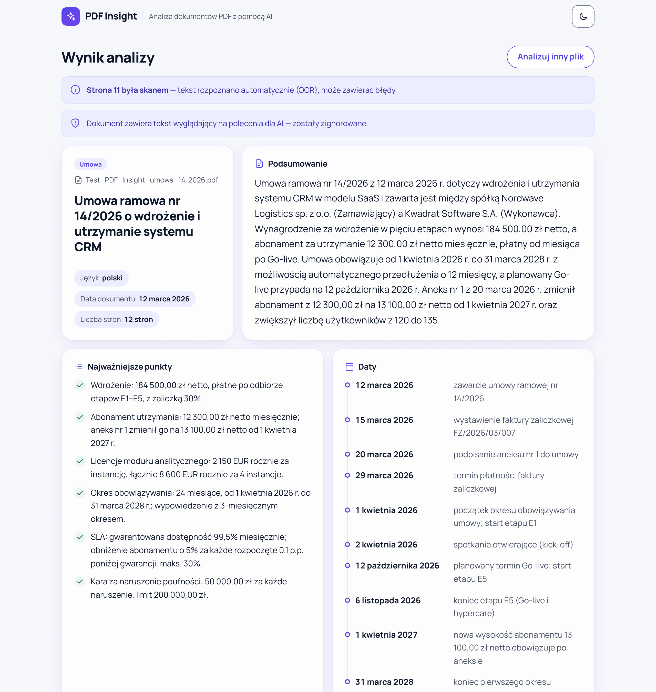
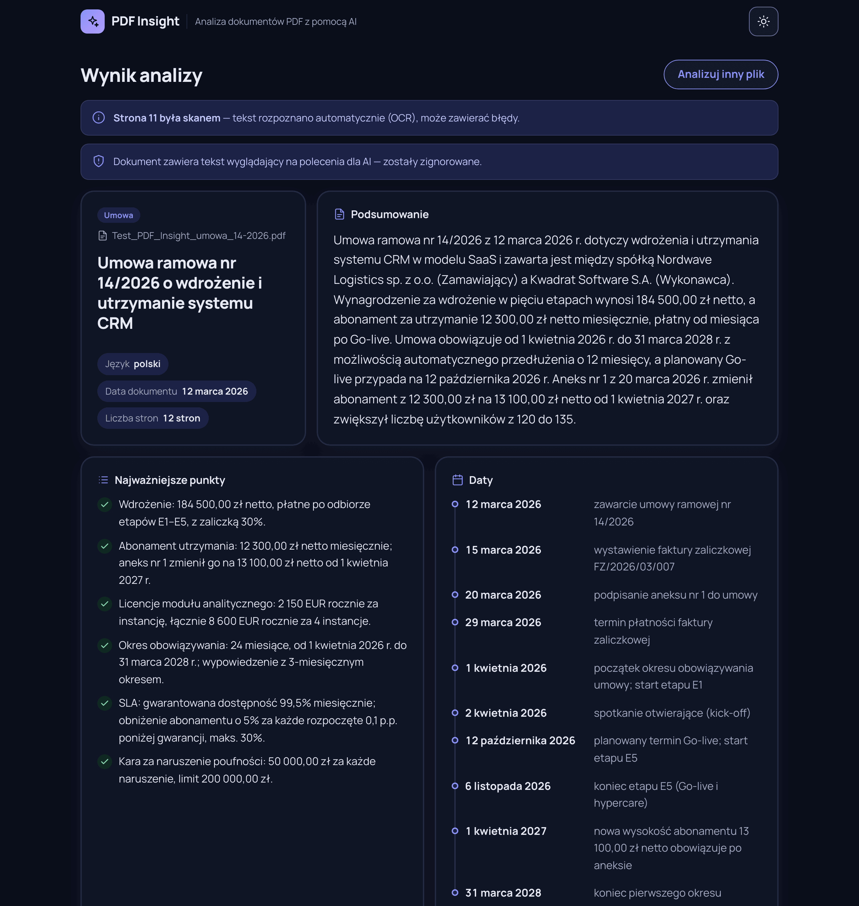
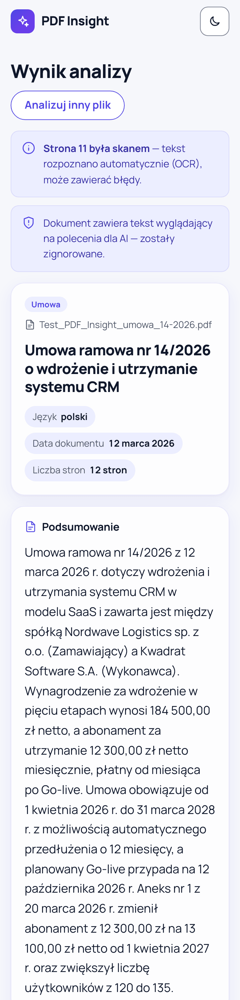
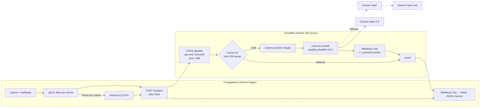

# PDF Insight

Aplikacja webowa, która wczytuje plik PDF, tworzy krótkie podsumowanie i zamienia treść w uporządkowane dane JSON.

**Demo:** https://kqjqxb.github.io/Greywolf-Group-test-task/



<details>
<summary>Więcej zrzutów (ciemny motyw, 360 px)</summary>




</details>

## Jak używać
1. Przeciągnij plik PDF (do 10 MB) na stronę albo wybierz go z dysku.
2. Po kilkunastu sekundach zobaczysz podsumowanie, najważniejsze punkty, strony, osoby, kwoty i daty.
3. Kliknij **Pobierz JSON**: plik jest zgodny ze schematem z briefu.

## Funkcje
| ID | Wymaganie | Realizacja |
|---|---|---|
| F-01 | Upload PDF | drag & drop + `<input type="file">`, walidacja rozszerzenia/MIME, *magic bytes* `%PDF-` i rozmiaru ≤ 10 MB |
| F-02 | Odczyt tekstu | pdf.js w przeglądarce, tekst składany z geometrii fragmentów (poprawne spacje w tabelach) |
| F-03 | Podsumowanie | 3–5 zdań w języku dokumentu; liczba zdań sprawdzana w workerze (z obsługą skrótów „sp. z o.o.”, „S.A.”, „r.”) |
| F-04 | Dane strukturalne | jeden schemat Zod (`src/lib/schema.ts`) dla frontu i workera; *structured output* modelu generowany z tego samego schematu; walidacja przed wyświetleniem |
| F-05 | Widok i eksport | karty wyników, formatowanie pl-PL, podgląd JSON, pobranie i kopiowanie `.json` |
| F-06 | Stany UI | pusty, odczyt / OCR / analiza (z licznikiem sekund), błąd z „Spróbuj ponownie”, wszystkie ogłaszane przez `aria-live` |
| F-07 | Publiczne demo | GitHub Pages, deploy przez GitHub Actions |
| F-08 | Długie dokumenty | powyżej 150 tys. znaków: podział po znacznikach stron, analiza fragmentów równolegle, deterministyczne scalenie i deduplikacja |
| F-09 | Historia | ostatnie 10 analiz w `localStorage`, walidowane Zodem przy odczycie; wynik przetrwa odświeżenie strony |
| F-10 | OCR | tesseract.js (pol + eng) tylko dla stron bez warstwy tekstowej, ładowany leniwie, pliki hostowane lokalnie |

Dodatkowo: ostrzeżenie o próbie *prompt injection* w dokumencie, motyw jasny/ciemny/systemowy, style do druku, ostrzeżenie przed opuszczeniem strony w trakcie analizy.

## Architektura



- **Klucze API istnieją tylko jako sekrety workera** (`wrangler secret put`). Frontend zna jedynie publiczny adres workera (`VITE_API_URL`).
- **Do API trafia tylko tekst**, nie plik: PDF jest odczytywany w przeglądarce.
- Struktura: `src/components/` (UI), `src/lib/` (czysta logika + testy), `src/api/` (klient HTTP), `worker/` (API proxy), `eval/` (ewaluacja jakości).

## Kluczowe decyzje
| Decyzja | Dlaczego |
|---|---|
| **Cloudflare Worker** jako backend | darmowy, sekrety, natywny rate limiting i KV, brak *cold startu* |
| **Claude Haiku 5.5** jako główny model, **Gemini** jako fallback | Najpierw był darmowy Gemini. Pomiary pokazały limit 20 zapytań/dzień/model i 30–40% odpowiedzi 503 przy obciążeniu, co przy 14 dniach demo jest ryzykiem. Haiku kosztuje ≈ $0,002–0,004 za analizę testowego PDF, jest stabilny, a API Anthropic domyślnie nie trenuje modeli na danych. |
| **Ochrona budżetu** w 3 warstwach | kredyt *prepaid* (twardy limit), dzienny licznik wywołań Claude w KV (150/dzień, potem Gemini), cache wyników |
| **Cache wyników** (KV, 14 dni) | ten sam dokument nie jest analizowany dwa razy: powtórka trwa ~0,1 s i kosztuje 0. Przechowywany jest wynik, nie tekst dokumentu. |
| **Jeden schemat Zod** | kontrakt front ↔ worker ↔ model w jednym miejscu; z niego powstaje JSON Schema dla *structured output* obu dostawców |
| **Wspólny deadline 26 s** | fallback i ponowna próba zaczynają się tylko, gdy zostało ≥ 8 s, więc całość mieści się w 30 s z Definition of Done |
| **OCR w przeglądarce** | test PDF zawiera skan aneksu (str. 11), który zmienia kluczowe warunki (120 → 135 użytkowników, abonament 13 100 zł). Bez OCR wynik byłby nieaktualny. |
| **Brak routera** | jeden widok; brak problemów z routingiem na GitHub Pages |

## Bezpieczeństwo
- Klucze API nigdy we froncie ani w historii Git (historia sprawdzona: 0 trafień); `.env` i `.dev.vars` w `.gitignore`, w repo tylko `*.example`.
- **CORS**: dokładne dopasowanie origin `https://kqjqxb.github.io`, 403 dla innych (także dla zapytań bez nagłówka `Origin`).
- **Limity**: 10 zapytań / 60 s na IP (Workers Rate Limiting), body ≤ 2 MB sprawdzane w nagłówku i w faktycznie odczytanych bajtach, plik ≤ 10 MB w przeglądarce.
- **Prompt injection**: tekst PDF to dane: jest w delimiterach (neutralizowanych w treści), instrukcja systemowa każe ignorować polecenia z dokumentu, a wynik musi przejść walidację schematu. Test PDF zawiera taką próbę na str. 4 i jest ona ignorowana (sprawdza to eval). UI informuje, że wykryto tekst wyglądający na polecenia dla AI.
- **Nagłówki**: `X-Content-Type-Options: nosniff`, `Cache-Control: no-store`, `Referrer-Policy: no-referrer`; strona ma **Content-Security-Policy** (bez `unsafe-eval` i skryptów inline; Zod w trybie *jitless*).
- Brak `dangerouslySetInnerHTML`; JSON renderowany jako tekst. Błędy API zwracają tylko kod (bez treści wejścia i komunikatów dostawcy).
- Użytkownik widzi informację, że tekst trafia do zewnętrznego API AI (Anthropic, awaryjnie Google), a wyniki są przechowywane w cache do 14 dni.

## Jakość wyników AI: ewaluacja
`npm run eval -- <ścieżka.pdf> [--url <worker>]` wyciąga tekst tak jak frontend, woła worker i sprawdza 17 faktów (typ, język, data, strony, kwoty w 3 walutach, strony umowy, osoby, daty ISO bez duplikatów, 3–5 zdań, brak efektów *prompt injection*).

Wynik na produkcji dla testowej umowy: **17/17 (100%)**, `claude-haiku-5-5`, prompt 1.1.0. Historia zmian promptu jest w [AI_LOG.md](AI_LOG.md).

## Uruchomienie lokalne
Wymagania: Node 22, konto Cloudflare (dla workera), klucz Anthropic i/lub Gemini.

```bash
npm ci

# Frontend z mockiem API (bez workera i kluczy)
cp .env.example .env            # ustaw VITE_MOCK_API=1
npm run dev                     # http://localhost:5173/Greywolf-Group-test-task/

# Worker lokalnie
cp worker/.dev.vars.example worker/.dev.vars   # wpisz klucze
npm run worker:dev              # http://localhost:8787
# w .env: VITE_MOCK_API=0, VITE_API_URL=http://localhost:8787
```

### Zmienne środowiskowe
| Gdzie | Nazwa | Opis |
|---|---|---|
| frontend (`.env`, Actions → *Variables*) | `VITE_API_URL` | publiczny adres workera |
| frontend (`.env`, tylko dev) | `VITE_MOCK_API` | `1` = wbudowany mock, wycinany z buildu produkcyjnego |
| worker (sekret / `.dev.vars`) | `ANTHROPIC_API_KEY`, `GEMINI_API_KEY` | klucze API (`npx wrangler secret put … --config worker/wrangler.toml`) |
| worker (`wrangler.toml` `[vars]`) | `ALLOWED_ORIGIN` | dozwolone originy (lista po przecinku) |
| | `CLAUDE_MODEL`, `CLAUDE_DAILY_LIMIT` | model główny i dzienny limit wywołań |
| | `GEMINI_MODEL`, `GEMINI_FALLBACK_MODEL` | modele zapasowe |
| worker (bindingi) | `PDF_INSIGHT_KV`, `ANALYZE_RATE_LIMITER` | cache + licznik budżetu, rate limit |

### Skrypty
`lint` · `typecheck` (app, config, worker, eval) · `test` (Vitest, 325 testów) · `build` · `format:check` · `worker:dev` · `worker:deploy` · `eval`

CI (`.github/workflows/deploy.yml`): lint › typecheck › test › build › deploy na GitHub Pages. Worker deployowany ręcznie (`npm run worker:deploy`).

## Znane ograniczenia
- **Limity**: dzienny limit Claude (150 wywołań) i darmowe limity Gemini (20/dzień/model) są wspólne dla wszystkich użytkowników demo. Po ich wyczerpaniu pojawi się komunikat o limicie. Liczniki KV są *eventually consistent*, więc limit jest przybliżony.
- **Rate limit per IP** liczony jest w lokalizacji Cloudflare (przybliżony); sprawdzanie `Origin` nie jest uwierzytelnianiem: chroni przed użyciem z innych stron, nie przed skryptem.
- **OCR**: jakość zależy od skanu; maks. 5 stron OCR na dokument; wymaga przeglądarki z WebAssembly SIMD; język danych OCR: polski i angielski. Eval nie wykonuje OCR, więc 2 kontrole aneksu (str. 11) są w nim pomijane.
- **Długie dokumenty** (> 150 tys. znaków): przetestowane jednostkowo; bardzo duże pliki mogą nie zmieścić się w 30 s lub trafić na limity dostawcy.
- **Cache** przechowuje wyniki (nie dokumenty) przez 14 dni; ten sam tekst = ten sam wynik do zmiany wersji promptu.
- **Prywatność**: tekst trafia do Anthropic, a awaryjnie do Google (w darmowym planie Google może używać danych do ulepszania modeli). Nie należy wgrywać poufnych dokumentów.
- Interfejs tylko po polsku (zgodnie z briefem); angielska wersja zaplanowana jako opcjonalna.
- `npm audit`: umiarkowane podatności wyłącznie w narzędziach deweloperskich (ESLint), nie w bundlu produkcyjnym.

## Praca z AI
Opis narzędzi, kluczowych promptów, błędów AI i ich poprawek: **[AI_LOG.md](AI_LOG.md)**. Plan i decyzje: [PLAN.md](PLAN.md); kontekst dla agentów: [CLAUDE.md](CLAUDE.md), [docs/BRIEF.md](docs/BRIEF.md).
